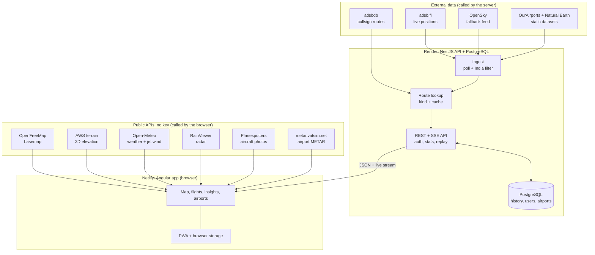
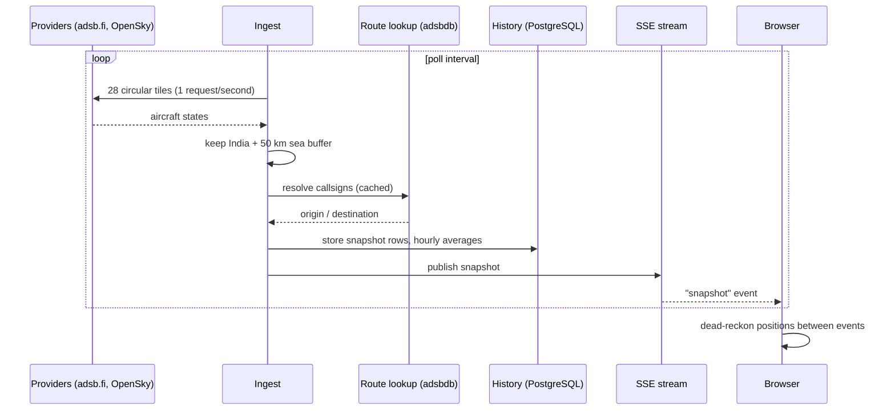
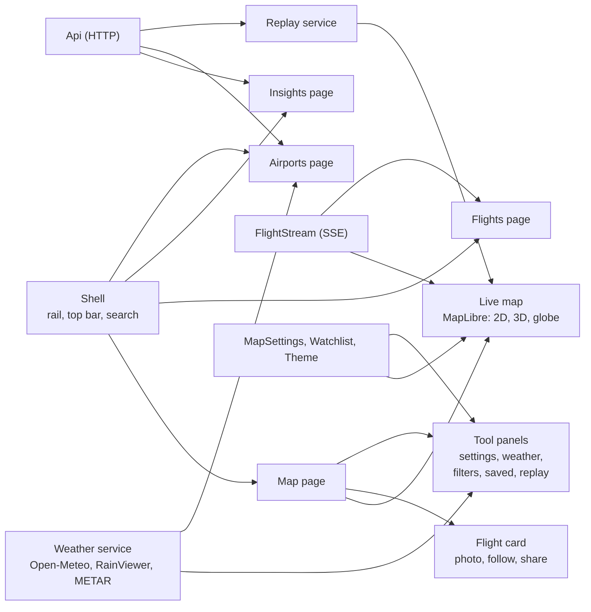
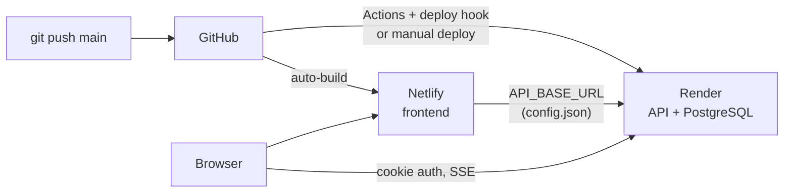

# Architecture

How Flight Radar India is put together: the moving parts, where data comes from, what
runs on the server and what runs in the browser. The diagrams are Mermaid, so GitHub
renders them inline.

For running and deploying see the [README](../README.md) and
[DEPLOYMENT.md](DEPLOYMENT.md).

## 1. Big picture



The server fetches flight data once and shares it with everybody. Weather, photos, tiles
and METAR are fetched by each browser directly, so they never load the Render instance.

## 2. Live data cycle (every ~75 s)



Between two snapshots the browser moves each plane along its heading, so markers glide.
If every provider fails the last good snapshot is kept and the feed chip says so.

## 3. Repository layout

```
flight-radar-dashboard/
├─ backend/                    NestJS 12 API (ESM, vitest)
│  ├─ src/
│  │  ├─ ingest/               adsb.fi + OpenSky providers, tiling, poll loop
│  │  ├─ flights/              India filter, route lookup, flight kind, REST
│  │  ├─ stream/               Server-Sent Events
│  │  ├─ history/              snapshots, stats, per-flight track, replay
│  │  ├─ airports/             search, pins, arrivals/departures board
│  │  ├─ auth/                 login, JWT cookie, global guard, rate limits
│  │  ├─ db/                   TypeORM entities, migrations, data source
│  │  └─ config/               environment parsing and validation
│  ├─ data/                    India polygon, neighbours, pre-built buffered area
│  └─ scripts/                 build-india-area, embedded dev PostgreSQL
├─ frontend/                   Angular 22 app (standalone, signals, zoneless)
│  ├─ src/app/
│  │  ├─ core/                 api, live stream, replay, weather, METAR, solar,
│  │  │                        settings, watchlist, theme, PWA install
│  │  ├─ layout/               shell: rail / tab bar, top bar, search, themes
│  │  ├─ pages/                map page: tools, panels, emergency banner
│  │  ├─ map/                  MapLibre live map, flight card
│  │  ├─ kpi/ flights/ insights/ airports/ charts/ login/
│  ├─ public/                  manifest, service worker, icons, _headers
│  └─ scripts/                 runtime config, icons, prod-like server
├─ docs/                       ARCHITECTURE.md, DEPLOYMENT.md
├─ render.yaml  netlify.toml  docker-compose.yml  Caddyfile
└─ .github/workflows/          render-deploy.yml (deploy hook)
```

## 4. Backend modules

| Module | Responsibility |
| --- | --- |
| `ingest` | Polls providers in `PROVIDER_ORDER`, splits India into circular tiles, handles back-off |
| `flights` | Keeps only aircraft over India (+ sea buffer), classifies arrival / departure / domestic / overflight / unknown, resolves routes |
| `stream` | `GET /api/stream` (SSE): a snapshot on connect and after every refresh |
| `history` | Writes `flight_snapshots` and `stats_hourly`; serves stats, tracks and replay frames |
| `airports` | Search, map pins, live board for one airport |
| `auth` | Seed admin in `users`, httpOnly cookie, per-IP and per-email lockout |
| `db` | Entities and migrations (`flight_snapshots`, `stats_hourly`, `airports`, `users`) |

### API surface

| Endpoint | Purpose |
| --- | --- |
| `GET /api/stream` | SSE snapshots |
| `GET /api/flights/live` | Latest flights as JSON |
| `GET /api/flights/:icao24/track` | Recorded path of one aircraft |
| `GET /api/stats/hourly`, `top-airports`, `airlines` | Insights charts |
| `GET /api/airports`, `/pins`, `/:code` | Search, pins, board |
| `GET /api/replay/range`, `GET /api/replay` | Recorded traffic frames for playback |
| `POST /api/auth/login`, `logout`, `GET /api/auth/me` | Session |
| `GET /api/health` | Liveness probe |

## 5. Database

| Table | Content | Kept |
| --- | --- | --- |
| `flight_snapshots` | One row per flight per poll cycle | `RETENTION_DAYS` |
| `stats_hourly` | Running hourly averages | forever |
| `airports` | Indian airports (OurAirports) | forever |
| `users` | Seed admin (bcrypt hash) | forever |

## 6. Frontend structure



State is held in signals in small root services (`FlightStream`, `MapSettings`,
`FlightSelection`, `Replay`, `Watchlist`, `ThemeService`); components read them and the
map reacts through effects.

## 7. Data sources

| Source | Called by | Key | Used for | Terms |
| --- | --- | --- | --- | --- |
| adsb.fi open data | server | no | live positions (primary) | non-commercial, credit, 1 req/s |
| OpenSky Network | server | optional | fallback positions | anonymous ~400 credits/day |
| adsbdb | server | no | callsign to route | free; routes can be wrong |
| OurAirports | build/seed | no | airport list, pins, search | public domain |
| Natural Earth | build/seed | no | India polygon, neighbours mask | public domain |
| OpenFreeMap | browser | no | basemap tiles | OSM attribution |
| AWS terrain tiles | browser | no | 3D elevation | open data |
| Open-Meteo | browser | no | conditions, 250 hPa wind | non-commercial |
| RainViewer | browser | no | radar overlay | credit, zoom 7 |
| Planespotters | browser | no | aircraft photos | photographer credit |
| metar.vatsim.net | browser | no | airport METAR | unofficial mirror of NOAA |

Hosts that the browser calls are allow-listed in the Content-Security-Policy
(`frontend/public/_headers`, `frontend/nginx/security-headers.conf`, `netlify.toml`).

## 8. Deployment



- The frontend reads the API origin from `/config.json` at run time, so the same build
  works against any backend.
- Auth uses an httpOnly cookie; across sites (Netlify to Render) it needs
  `COOKIE_SAMESITE=none` and CORS for the Netlify origin.
- Render's free instance sleeps after about 15 minutes; the first request wakes it.

## 9. Security notes

- Every API route except login, logout and health is behind a global JWT guard.
- `AUTH_DISABLED` and `LOGIN_RATE_LIMIT=off` are refused when `NODE_ENV=production`.
- The service worker never caches `/api`, `/config.json` or cross-origin requests.
- Browser-direct calls (weather, photos, METAR) reveal the visitor's IP to those services;
  nothing from them is sent to the backend.

## 10. Known limits

- ADS-B only: aircraft without a transponder and receiver gaps are missing.
- Routes are callsign-derived; 20-35 % of flights have none and some are wrong.
- Delayed flights cannot be computed from free feeds (no schedule data).
- Replay and trails reflect what the backend recorded; gaps appear when it was down.
- Single backend instance assumed (in-memory route cache, rate limiter, sessions).
